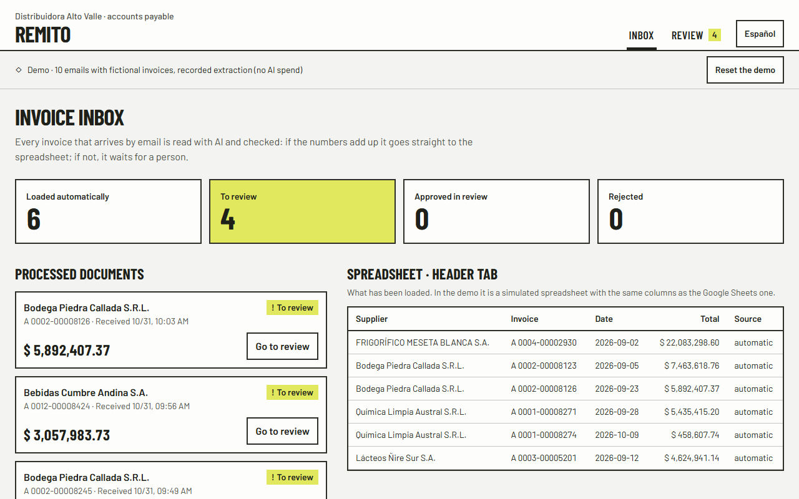
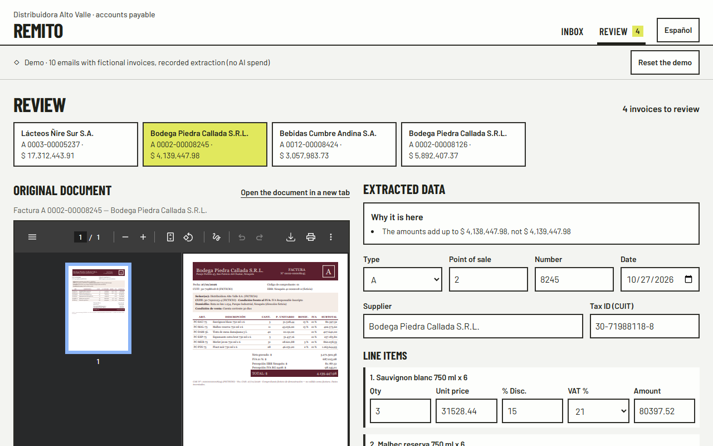
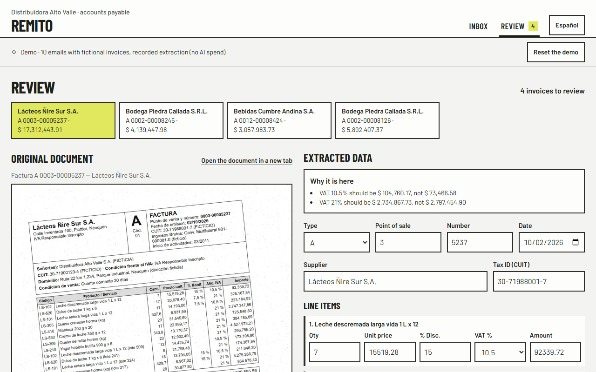
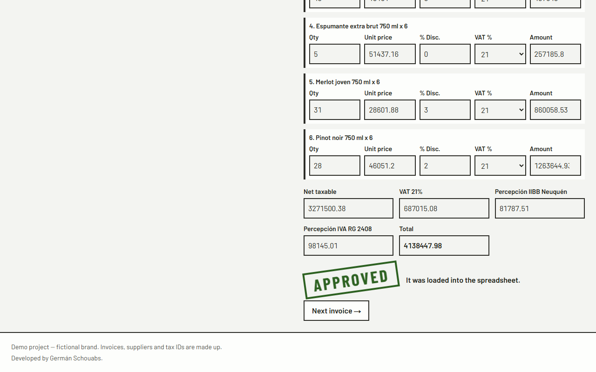
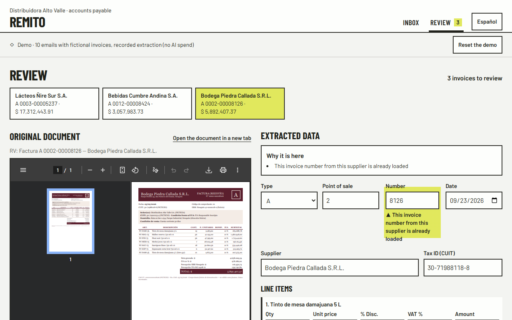
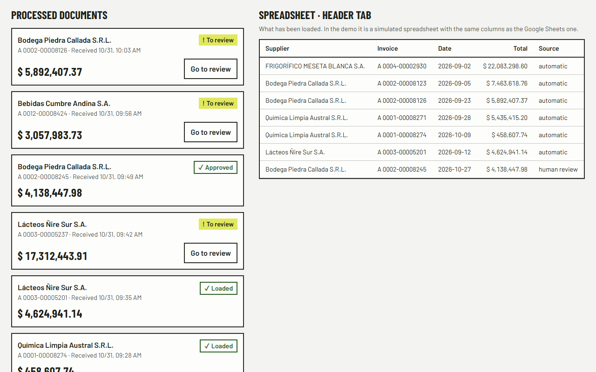
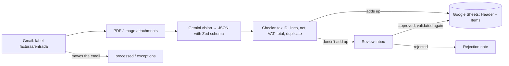

# Remito · Supplier invoices read with AI, checked, and reviewed by a person

Reads the invoices that arrive by email (PDF or photo), extracts the data with Gemini vision into validated JSON, checks
the arithmetic and duplicates, loads what adds up into Google Sheets and sends anything doubtful to a review inbox.
· [Versión en español](README.md)


> **Demo project.** "Distribuidora Alto Valle" and its six suppliers are fictional. The 55 invoices are generated by a
> script with a fixed seed, with made-up tax IDs marked "(FICTICIO)" and the notice "Comprobante ficticio de
> demostración — no válido como factura" (fictional demo document, not a valid invoice). There are no real invoices in
> the repository. The invoices are Argentine (types A and B, VAT, CUIT tax IDs), so they are in Spanish.

## The problem

A distributor receives dozens of supplier invoices by email: PDFs from different billing systems, phone photos, crooked
scans. Someone in accounts payable opens them one by one and copies supplier, number, date, line items, VAT and total
into a spreadsheet. It is slow and mistakes slip through: a total that doesn't add up, VAT charged at the wrong rate,
the same invoice sent twice.

## The solution

- **Reads the Gmail inbox:** takes the emails labeled `facturas/entrada`, downloads the attachments (PDF, PNG, JPEG) and
  moves them to `procesadas` (processed) or `excepciones` (exceptions).
- **Extracts with Gemini vision** a schema-validated JSON (Zod): invoice type A/B, supplier and tax ID, point of sale and
  number, date, line items, net amount, VAT per rate, tax withholdings and total. If it doesn't validate, one retry with
  the error; if it fails again, it goes to review (nothing is filled in by guesswork).
- **Checks every invoice:** tax ID check digit, a date that exists, each line (quantity × price − discount), net amount,
  base and VAT for each rate, total, and duplicates by tax ID + type + point of sale + number. Each problem names the
  field and the numbers: "The amounts add up to $ 4,138,447.98, not $ 4,139,447.98".
- **Loads into Google Sheets** what adds up (Header and Items tabs), without duplicating rows even if a run is cut off.
- **Review inbox:** the original document on the left and editable data on the right, validated live with the same
  checks. Whatever doesn't add up is flagged with the reason. Approving validates again; a duplicate can only be
  rejected; loading something that doesn't add up asks for confirmation and is recorded. In English and Spanish.

## Demo

- Live: https://remito-xi.vercel.app/en. It is the demo with 10 sample emails processed with recorded Gemini responses:
  no keys, no requests to Google, no spend. The inbox lives in server memory and is shared by visitors: "Reset the
  demo" takes it back to the start.
- Locally: `npm run dev` → http://localhost:3205/en.

Result: **6 invoices loaded automatically and 4 sent to review** (a total $ 1,000 too high, VAT charged at 19%, a tilted
photo where the AI misread a VAT rate, and a resent invoice that was already loaded).

| | |
|---|---|
|  |  |
|  |  |
|  |  |

## Architecture



- **One validation** for everything: the pipeline, the review inbox (live, while the person corrects) and the approval
  all use it. They are pure functions with tests.
- **Idempotent:** an attachment already read is never sent to Gemini again, the spreadsheet doesn't repeat keys, line
  items aren't written twice if a run was cut off, and a file lock prevents two runs at once.
- **Google integration** with typed errors, timeouts, retries only on network/429/5xx (honoring `Retry-After`) and no
  retries on anything that creates something. Details in [`docs/integracion-google.md`](docs/integracion-google.md)
  (Spanish).
- **Two modes:** the demo (default, and on any deployment) uses memory and recorded responses. Real mode only starts
  with `npm run dev:real`, which listens on 127.0.0.1, and any request with a non-local Host gets a 403.

## Stack and skills shown

AI document processing (Gemini vision, structured output) · validation with Zod and business rules · Gmail API ·
Google Sheets API · desktop OAuth 2.0 with PKCE · human-in-the-loop · Next.js 16 · strict TypeScript · Tailwind 4 ·
Vitest · Playwright · axe-core · Lighthouse · sharp.

## How to run it

```bash
npm install
npm run dev                 # demo → http://localhost:3205/en
npm test                    # 67 unit tests
npm run accuracy -- --sin-red   # measures accuracy with the recorded responses (no quota used)
```

To measure with Gemini for real or use a real inbox:

```bash
cp .env.example .env.local  # GEMINI_API_KEY; for Gmail and Sheets, the desktop OAuth client
npm run check-env           # OK/FALTA (missing) per variable, values never shown
npm run facturas            # regenerates the 55 fictional invoices (same seed, same result)
npm run accuracy            # extracts all 55 with Gemini and compares them with the golden set
npm run google:autorizar    # desktop OAuth (opens the browser; stores the refresh token)
npm run planilla:crear      # creates the spreadsheet with the Header and Items tabs
npm run mails:demo          # sends the 10 test emails to the authorized inbox (and no other)
npm run procesar            # reads the inbox, extracts, checks and loads
npm run dev:real            # the review inbox with the real mailbox and spreadsheet, on this PC only
```

## Tests and measured results

Accuracy with `gemini-3.5-flash-lite` on the 55-invoice golden set (Oct 31, 2026, `docs/resultados/accuracy.json`).
"Key fields" are supplier, number, date, total and line items; "document" means all of them exact at once.

| Field | 40 clean | 10 degraded photos and scans | 5 with planted errors |
|---|---|---|---|
| Supplier | 40/40 | 10/10 | 5/5 |
| Number | 40/40 | 10/10 | 5/5 |
| Date | 40/40 | 10/10 | 5/5 |
| Total | 40/40 | 10/10 | 5/5 |
| Line items | 40/40 | 9/10 | 5/5 |
| **Exact document** | **40/40 (100%)** | **9/10** | **5/5** |
| **Key fields** | **200/200 (100%)** | **49/50 (98%)** | **25/25** |

- **Planted errors caught: 5/5** (2 totals that don't add up, 2 wrong VAT amounts, 1 duplicate).
- **The only misread didn't get through as valid:** on D07 (photo rotated 6.6°) it read one line with 10.5% VAT instead
  of 21%; the VAT didn't add up and the invoice went to review.
- 0 retries for invalid JSON.

| Test | Result |
|---|---|
| Latency per invoice (Gemini) | **p50 3.6 s · p95 5.4 s** |
| Cost per invoice | **USD 0.0027** (≈ 1,930 tokens, Flash-Lite paid-tier price); on the free tier, USD 0 |
| Unit tests (`npm test`) | **67/67**: validators and tax ID, golden set, extraction and retry, idempotent inbox, Gmail and Sheets with mocked responses (401, 404, 429, 503, timeout, schema) |
| e2e (`npm run test:e2e`, phone and desktop) | **12/12**: inbox 6/4, approve after correcting, force, duplicate, English, protected API |
| Accessibility (axe, WCAG 2.1 AA) | **0 serious or critical violations** in 8 checks |
| Lighthouse mobile (median of 3) | `/` **98**/100/100/100 · `/revision` **94**/100/100/100 · `/en/revision` **93**/100/100/100 |

### Minutes saved (estimate with stated assumptions)

This is not client data: it is a calculation whose assumptions each company should replace with its own.

```
minutes saved per month = N × t_entry − N × review_rate × t_review
```

- `N`: invoices per month. Example: **100**.
- `t_entry`: minutes to enter one invoice by hand with its line items. **Assumption: 3 min.**
- `review_rate`: the share that goes to review. **Measured on the set: 6/55 = 10.9%** (5 with deliberately planted
  errors plus the tilted photo).
- `t_review`: minutes to review one with the document alongside and the reason flagged. **Assumption: 2 min.**

With those values: 100 × 3 − 100 × 0.109 × 2 = 300 − 21.8 ≈ **278 minutes per month (4.6 hours)**, for USD 0.27 of
Gemini.

## Estimated running costs

| Item | Cost |
|---|---|
| Extraction with Gemini 3.5 Flash-Lite (paid tier) | ≈ USD 0.0027 per invoice (USD 0.27 per 100); free tier USD 0 with a daily limit |
| Gmail API and Google Sheets API | USD 0 (free Google Workspace API quotas) |
| Hosting the review inbox (Vercel Hobby) | USD 0 for the demo |
| Re-measuring with the recorded responses | USD 0 |

## Limits and next steps

- The test invoices come from 6 layouts. With real supplier invoices, accuracy must be measured again and the prompt
  adjusted if needed.
- Tilted photos are the weak spot: the checks stop them, but the person has to fix the line.
- It doesn't validate against AFIP, Argentina's tax agency (invoice verification or tax ID registry); that is the
  natural next step.
- The public demo keeps the inbox in the instance's memory: when it restarts, it goes back to the start.
- Next steps: AFIP verification, purchase orders for three-way matching, and export to the accounting system.

## Authorship

Developed by Germán Schouabs.

## License

MIT. See [LICENSE](LICENSE).
