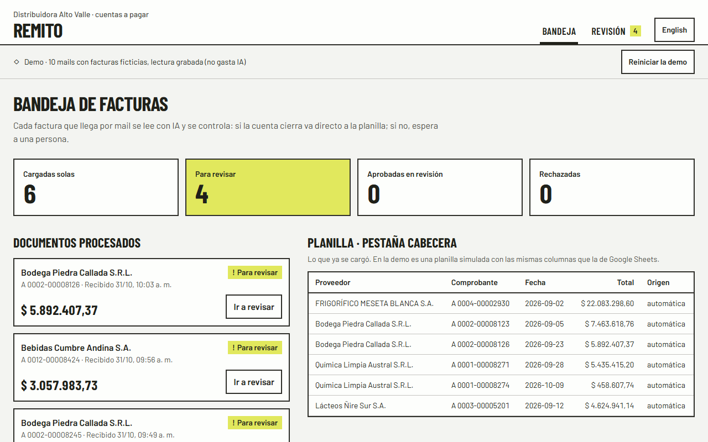
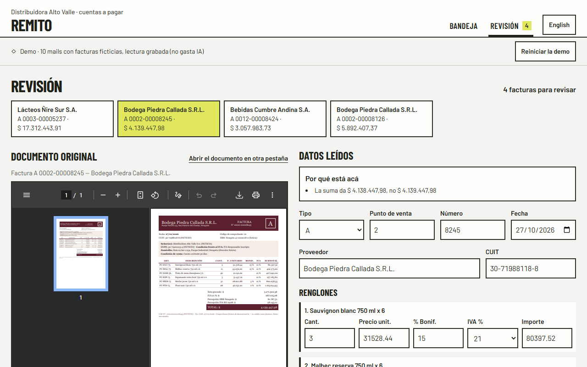
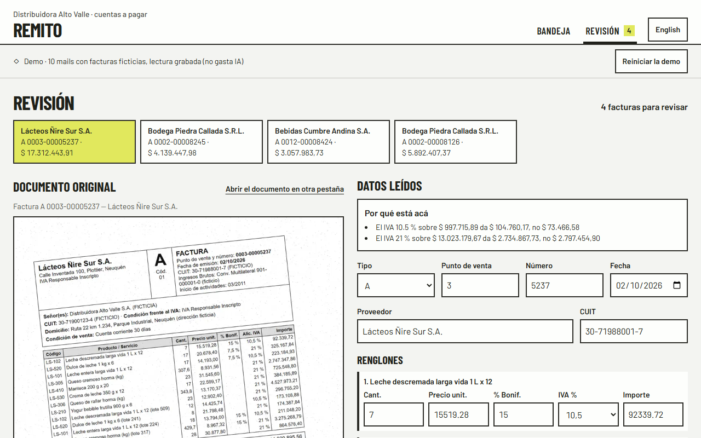
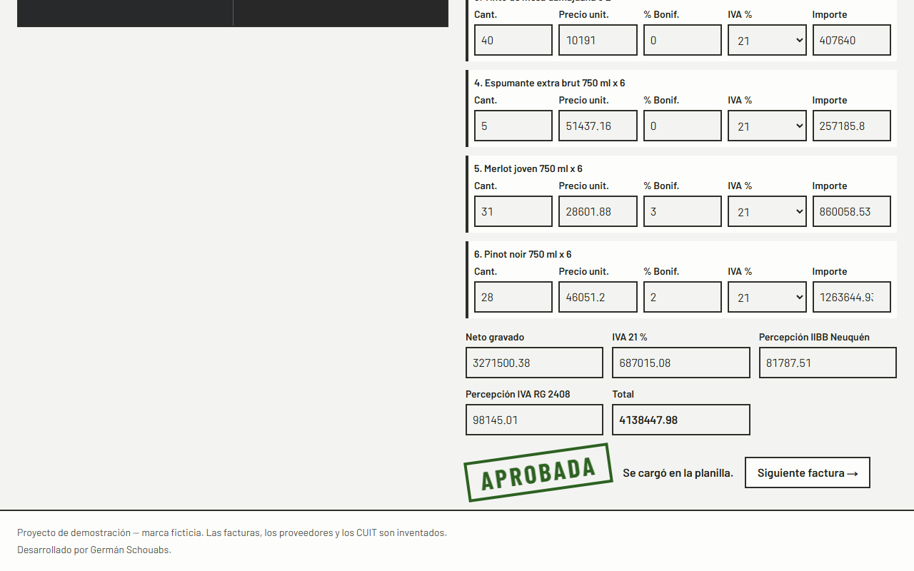
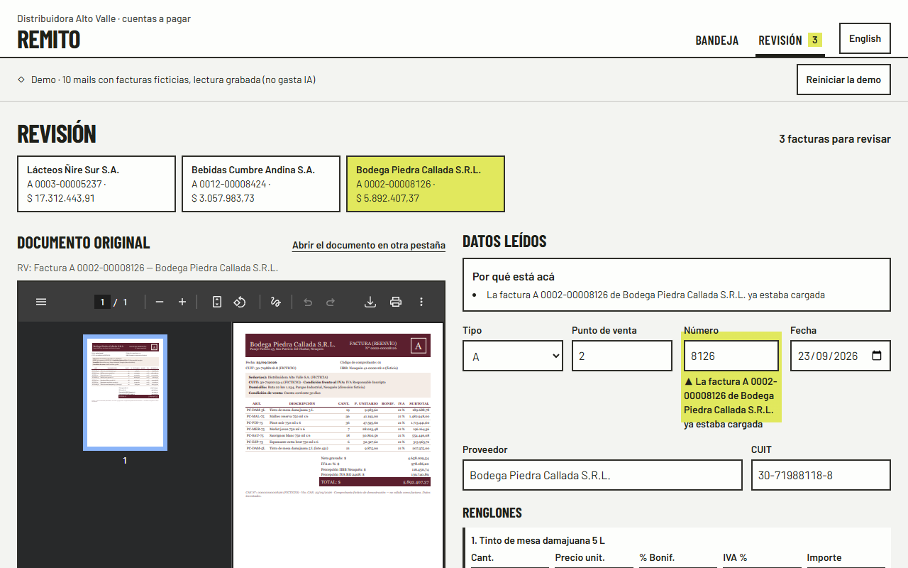
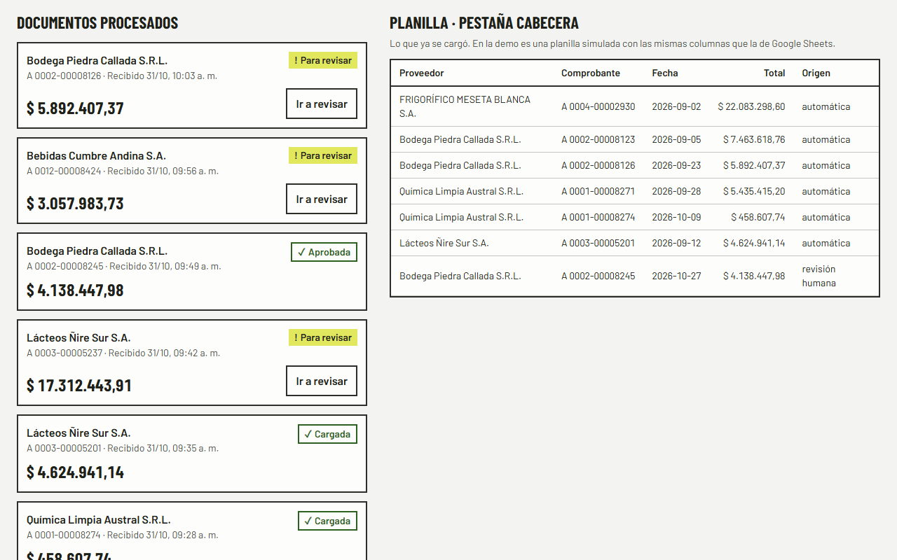
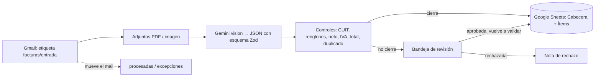

# Remito · Facturas de proveedores leídas con IA, controladas y con revisión humana

Lee las facturas que llegan por mail (PDF o foto), extrae los datos con Gemini vision en un JSON validado, controla la
aritmética y los duplicados, carga lo que cierra en Google Sheets y manda lo dudoso a una bandeja de revisión.
· [English version](README.en.md)


> **Proyecto de demostración.** "Distribuidora Alto Valle" y sus seis proveedores son ficticios. Las 55 facturas las
> genera un script con semilla fija, con CUIT inventados marcados "(FICTICIO)" y la leyenda "Comprobante ficticio de
> demostración — no válido como factura". No hay ninguna factura real en el repositorio.

## El problema

Una distribuidora recibe decenas de facturas de proveedores por mail: PDFs de sistemas distintos, fotos sacadas con el
celular, escaneos torcidos. Alguien de cuentas a pagar las abre una por una y copia proveedor, número, fecha, renglones,
IVA y total a una planilla. Es lento y los errores pasan: un total que no suma, un IVA mal liquidado, la misma factura
reenviada dos veces.

## La solución

- **Lee la casilla de Gmail:** toma los mails con la etiqueta `facturas/entrada`, baja los adjuntos (PDF, PNG, JPEG) y
  los mueve a `procesadas` o `excepciones`.
- **Extrae con Gemini vision** un JSON con esquema (Zod): tipo A/B, proveedor y CUIT, punto de venta y número, fecha,
  renglones, neto, IVA por alícuota, percepciones y total. Si no valida, un reintento con el error; si vuelve a fallar,
  va a revisión (no se completa nada a mano).
- **Controla cada factura:** CUIT con dígito verificador, fecha que exista, cada renglón (cantidad × precio −
  bonificación), neto, base e IVA de cada alícuota, total y duplicado por CUIT + tipo + punto de venta + número. Cada
  problema dice el campo y los números: "La suma da $ 4.138.447,98, no $ 4.139.447,98".
- **Carga en Google Sheets** lo que cierra (pestañas Cabecera e Ítems), sin duplicar filas aunque se corte a mitad.
- **Bandeja de revisión:** el documento original a la izquierda y los datos editables a la derecha, validados en vivo
  con los mismos controles. Lo que no cierra se marca con el motivo. Aprobar vuelve a validar; una duplicada solo se
  rechaza; cargar algo que no cierra pide confirmarlo y queda registrado. En español y en inglés.

## Demo

- En vivo: https://remito-xi.vercel.app (en inglés: https://remito-xi.vercel.app/en). Es la demo con 10 mails de
  ejemplo procesados con las respuestas de Gemini grabadas: no usa claves, no hace pedidos a Google ni gasta nada. La
  bandeja vive en la memoria del servidor y la comparten los visitantes: "Reiniciar la demo" la vuelve al inicio.
- En local: `npm run dev` → http://localhost:3205.

Resultado: **6 facturas cargadas solas y 4 para revisar** (un total con $ 1.000 de más, un IVA liquidado al 19 %, una
foto inclinada donde la IA leyó mal una alícuota y un reenvío de una factura ya cargada).

| | |
|---|---|
|  |  |
|  |  |
|  |  |

Capturas en inglés en [`docs/capturas/en/`](docs/capturas/en/).

## Arquitectura



- **Una sola validación** para todo: la usan el pipeline, la bandeja (en vivo, mientras la persona corrige) y la
  aprobación. Son funciones puras con tests.
- **Idempotente:** un adjunto ya leído no se vuelve a mandar a Gemini, la planilla no repite claves, los renglones no se
  escriben dos veces si se cortó a mitad, y un candado de archivo evita dos procesos a la vez.
- **Integración con Google** con errores tipados, timeout, reintentos solo ante red/429/5xx (con `Retry-After`) y sin
  reintento en lo que crea algo. Detalle en [`docs/integracion-google.md`](docs/integracion-google.md).
- **Dos modos:** la demo (por defecto y en cualquier deploy) usa memoria y respuestas grabadas. El modo real solo se
  abre con `npm run dev:real`, que escucha en 127.0.0.1, y cualquier pedido con un Host que no sea local da 403.

## Stack y skills demostradas

Procesamiento de documentos con IA (Gemini vision, salida estructurada) · validación con Zod y reglas de negocio ·
Gmail API · Google Sheets API · OAuth 2.0 de escritorio con PKCE · human-in-the-loop · Next.js 16 · TypeScript
estricto · Tailwind 4 · Vitest · Playwright · axe-core · Lighthouse · sharp.

## Cómo correrlo

```bash
npm install
npm run dev                 # demo → http://localhost:3205 (y /en)
npm test                    # 67 tests de unidad
npm run accuracy -- --sin-red   # mide la exactitud con las respuestas grabadas (no gasta cuota)
```

Para medir con Gemini de verdad o usar una casilla real:

```bash
cp .env.example .env.local  # GEMINI_API_KEY; para Gmail y Sheets, el cliente OAuth de escritorio
npm run check-env           # OK/FALTA por variable, sin mostrar valores
npm run facturas            # regenera las 55 facturas ficticias (misma semilla, mismo resultado)
npm run accuracy            # extrae las 55 con Gemini y compara contra el set dorado
npm run google:autorizar    # OAuth de escritorio (abre el navegador; guarda el refresh token)
npm run planilla:crear      # crea la planilla con las pestañas Cabecera e Ítems
npm run mails:demo          # manda los 10 mails de prueba a la casilla autorizada (y a ninguna otra)
npm run procesar            # lee la casilla, extrae, controla y carga
npm run dev:real            # la bandeja con la casilla y la planilla reales, solo en esta PC
```

## Tests y resultados medidos

Exactitud con `gemini-3.5-flash-lite` sobre el set dorado de 55 facturas (31/10/2026, `docs/resultados/accuracy.json`).
"Campos clave" son proveedor, número, fecha, total y renglones; "documento" es todo exacto a la vez.

| Campo | 40 limpias | 10 fotos y escaneos degradados | 5 con errores sembrados |
|---|---|---|---|
| Proveedor | 40/40 | 10/10 | 5/5 |
| Número | 40/40 | 10/10 | 5/5 |
| Fecha | 40/40 | 10/10 | 5/5 |
| Total | 40/40 | 10/10 | 5/5 |
| Renglones | 40/40 | 9/10 | 5/5 |
| **Documento exacto** | **40/40 (100 %)** | **9/10** | **5/5** |
| **Campos clave** | **200/200 (100 %)** | **49/50 (98 %)** | **25/25** |

- **Errores sembrados detectados: 5/5** (2 totales que no cierran, 2 IVA mal liquidados, 1 duplicada).
- **La única lectura mal hecha no pasó como buena:** en D07 (foto rotada 6,6°) leyó un renglón con IVA 10,5 % en vez de
  21 %; el IVA no cerraba y la factura fue a revisión.
- 0 reintentos por JSON inválido.

| Prueba | Resultado |
|---|---|
| Latencia por factura (Gemini) | **p50 3,6 s · p95 5,4 s** |
| Costo por factura | **USD 0,0027** (≈ 1.930 tokens, precio del plan pago de Flash-Lite); en el plan gratis, USD 0 |
| Tests de unidad (`npm test`) | **67/67**: validadores y CUIT, set dorado, extracción y reintento, bandeja idempotente, Gmail y Sheets con respuestas simuladas (401, 404, 429, 503, timeout, esquema) |
| e2e (`npm run test:e2e`, celular y compu) | **12/12**: bandeja 6/4, aprobar corrigiendo, forzar, duplicada, inglés, API protegida |
| Accesibilidad (axe, WCAG 2.1 AA) | **0 violaciones** serias o críticas en 8 revisiones |
| Lighthouse móvil (mediana de 3) | `/` **98**/100/100/100 · `/revision` **94**/100/100/100 · `/en/revision` **93**/100/100/100 |

### Minutos ahorrados (estimación con supuestos declarados)

No es un dato de un cliente: es una cuenta con supuestos que hay que reemplazar por los de cada empresa.

```
minutos ahorrados por mes = N × t_carga − N × tasa_revisión × t_revisión
```

- `N`: facturas por mes. Ejemplo: **100**.
- `t_carga`: minutos para cargar una factura a mano con sus renglones. **Supuesto: 3 min.**
- `tasa_revisión`: la parte que va a revisión. **Medida en el set: 6/55 = 10,9 %** (5 con errores sembrados a propósito
  y la foto inclinada).
- `t_revisión`: minutos para revisar una con el documento al lado y el motivo marcado. **Supuesto: 2 min.**

Con esos valores: 100 × 3 − 100 × 0,109 × 2 = 300 − 21,8 ≈ **278 minutos por mes (4,6 horas)**, a USD 0,27 de Gemini.

## Costos de operación estimados

| Concepto | Costo |
|---|---|
| Extracción con Gemini 3.5 Flash-Lite (plan pago) | ≈ USD 0,0027 por factura (USD 0,27 cada 100); en el plan gratis, USD 0 con límite diario |
| Gmail API y Google Sheets API | USD 0 (cupos gratuitos de Google Workspace APIs) |
| Hosting de la bandeja (Vercel Hobby) | USD 0 para la demo |
| Volver a medir con las respuestas grabadas | USD 0 |

## Límites y próximos pasos

- Las facturas de prueba son de 6 diseños. Con facturas de proveedores reales hay que medir de nuevo y, si hace falta,
  ajustar el prompt.
- Lo más flojo es la foto inclinada: los controles la frenan, pero la persona tiene que corregir el renglón.
- No valida contra AFIP (constatación de comprobantes ni padrón de CUIT); es el siguiente paso natural.
- La demo pública guarda la bandeja en memoria de la instancia: al reiniciarse vuelve al inicio.
- Próximos pasos: constatación en AFIP, órdenes de compra para el control de tres vías y exportación al sistema contable.

## Autoría

Desarrollado por Germán Schouabs.

## Licencia

MIT. Ver [LICENSE](LICENSE).
